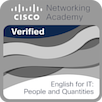
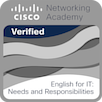

# 👋 Hi, I'm Alexandre 
Aspiring Infrastructure and Cloud Engineer focused on Linux, AWS, Docker, Networking, Monitoring, and Automation.
Currently pursuing a Postgraduate Specialization in Computer Networks while building hands-on experience through personal infrastructure, cloud, and networking projects.

# 🎯 Career Interests
- Infrastructure
- Cloud Computing
- Network Administration
- DevOps
- DevSecOps

# 🚀 Current Learning Path
- AWS Certified Solutions Architect – Associate
- Cisco CCNA
- Linux Administration
- Python for Network and Infrastructure Automation

# 💻 Technologies
- Linux
- AWS
- Docker
- Zabbix
- PostgreSQL
- Python
- Git

# 🛠 Projects
Coming soon...

# 🎓 Academic Background
- **Postgraduate Specialization in Computer Networks** (Universidade Tecnológica Federal do Paraná, Brazil)  
  *2026 – Present*
- **Bachelor's Degree in Information Systems** (Pontifícia Universidade Católica de Minas Gerais, Brazil)  
  *2022 – 2025*

# 🌎 Languages
- Portuguese (Native)
- English (CEFR C2)

# 🏅 Badges
## Course Badges
### From Cisco

 &nbsp;
<!--
## Hi there 👋

**afernandesabreu/afernandesabreu** is a ✨ _special_ ✨ repository because its `README.md` (this file) appears on your GitHub profile.

Here are some ideas to get you started:

- 🔭 I’m currently working on ...
- 🌱 I’m currently learning ...
- 👯 I’m looking to collaborate on ...
- 🤔 I’m looking for help with ...
- 💬 Ask me about ...
- 📫 How to reach me: ...
- 😄 Pronouns: ...
- ⚡ Fun fact: ...
-->
